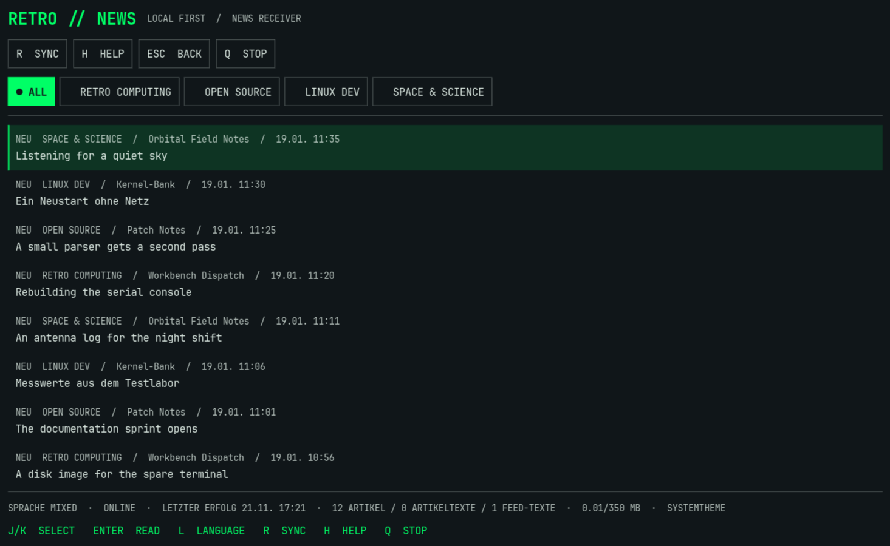

# RetroNews

**A native GTK4 reader for RSS and Atom on Linux. Read cached articles offline.**



[Article reader](docs/showcase/reader.png) · [Language filter](docs/showcase/language.png)

- Read feed summaries, supplied article text and optionally prefetched text and images.
- Browse by category or language and see the last refresh result for each source.
- Keep a bounded local cache and reopen it without a connection.

## Quickstart

Use Python 3.11+, GTK 4.8+, PyGObject and GdkPixbuf with PNG/JPEG decoders. Use your distribution's system Python so it can find the GTK bindings.

```bash
/usr/bin/python3 -m retronews
```

The first launch starts with an empty subscription list. Quit with **Q**, add a subscription in `${XDG_CONFIG_HOME:-$HOME/.config}/retronews/feeds.json`, then relaunch and press **R**. Use the arrow keys or **J/K** to move, **Enter** to open a cached article, **Esc** to return, **Tab** to change category, **L** to change language and **H** for help.

See [installation and subscriptions](docs/INSTALL.md) for distro packages, an offline user installation and a four-feed demo that uses only a local HTTP server.

## Network and privacy

RetroNews saves subscriptions and preferences in XDG config, article files in XDG cache and its SQLite index in XDG state. It contacts subscribed servers, their robots endpoints and eligible hosts for optional images and article prefetch. Those servers can see your IP address and the URLs you request. The application has no analytics, account system or cloud sync. See the [security and privacy notes](docs/SECURITY-PRIVACY.md).

## Verification and limitations

Run the offline test suite with `/usr/bin/python3 -m unittest discover -s tests -v` in a Linux desktop session with loopback available. The [test report](docs/TEST-REPORT.md) covers the Arch Linux and Wayland run.

The interface is primarily German. Subscription editing requires a restart. Category and language filters are available. Full-text search, feeds requiring authentication, proxy configuration and a browser view are outside this release. Extracted text and summaries can be incomplete.

[Release notes](docs/RELEASE-NOTES.md) · [Third-party notices](THIRD-PARTY-NOTICES.md) · [MIT License](LICENSE)
